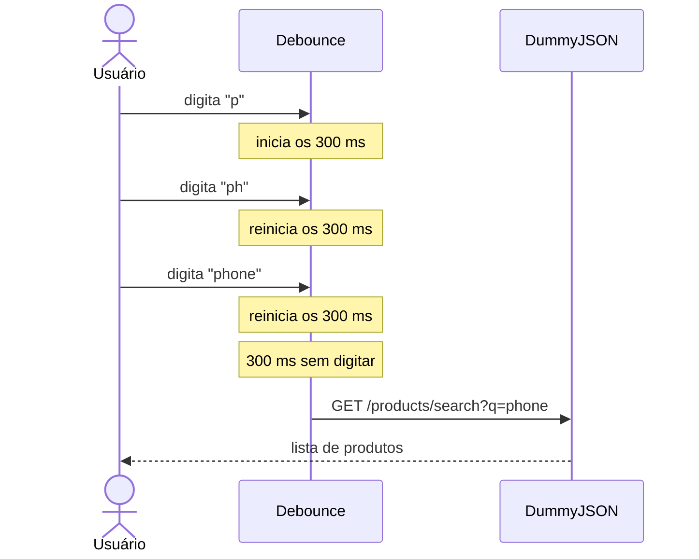

# 🔎 Busca com debounce


Desafio técnico #02: um campo de busca de produtos que espera você parar de digitar antes de chamar a API, feito só com HTML, CSS e JavaScript puro.

## 💡 O problema

Sem debounce, cada tecla pressionada dispara uma requisição. Digitar `phone` geraria uma busca para cada letra, gastando rede à toa e correndo o risco de uma resposta antiga aparecer por cima de uma mais nova.

Com debounce, cada nova tecla reinicia um temporizador de 300 ms, e a busca só acontece quando ele chega ao fim:



## ✨ Funcionalidades

- **Debounce de 300 ms:** a busca só é feita quando a digitação pausa.
- **Cancelamento de requisições:** uma nova busca aborta a anterior com `AbortController`.
- **Mínimo de 2 letras:** termos mais curtos não chegam a chamar a API.
- **Feedback de estado:** mostra se está buscando, quantos resultados vieram, se nada foi encontrado ou se houve falha.
- **Acessibilidade:** o status é anunciado por leitores de tela (`aria-live`) e as animações respeitam `prefers-reduced-motion`.
- **Layout responsivo:** tema escuro inspirado em editores de código, que se adapta a telas pequenas.

## 🧠 Como funciona

O centro do projeto é uma função de poucas linhas, que usa uma closure para guardar o temporizador entre as chamadas:

```js
function debounce(funcao, espera = 300) {
  let temporizador;
  return (...args) => {
    clearTimeout(temporizador);
    temporizador = setTimeout(() => funcao(...args), espera);
  };
}

campo.addEventListener('input', debounce(aoDigitar, 300));
```

Debounce e `AbortController` resolvem problemas diferentes e se complementam:

| Técnica | O que evita |
| --- | --- |
| `debounce` | Requisições desnecessárias enquanto a pessoa ainda está digitando |
| `AbortController` | Resposta antiga sobrescrevendo uma mais recente, quando a busca anterior ainda não terminou |

## 🚀 Como rodar

O `main.js` é carregado como módulo (`type="module"`), e os navegadores bloqueiam módulos abertos direto via `file://`. Por isso, é preciso servir a pasta com um servidor local. Use uma das opções:

```bash
git clone https://github.com/kauan-meirelles/desafio02-debounce.git
cd desafio02-debounce

# com Node.js
npx serve

# ou com Python
python -m http.server 8000
```

Depois, abra o endereço mostrado no terminal (no caso do Python, `http://localhost:8000`). A extensão **Live Server** do VS Code também funciona.

Você vai precisar de internet, já que os produtos vêm da API pública [DummyJSON](https://dummyjson.com/docs/products). Experimente buscar por `phone` ou `laptop`.

## 📁 Estrutura

```text
.
├── index.html   # estrutura da página
├── main.js      # debounce, chamada à API e atualização da lista
└── style.css    # tema escuro e animações
```

---

Feito por [Kauan Meirelles](https://github.com/kauan-meirelles)
